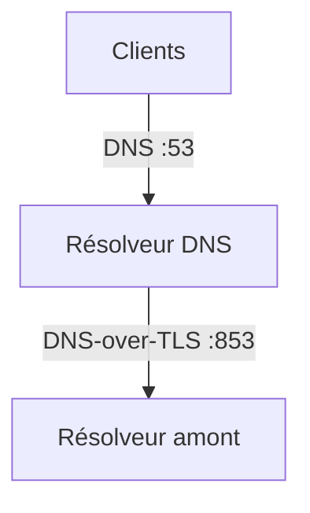

# Diagrammes d’architecture

Les schémas d’architecture sont rendus en SVG statique depuis Mermaid. Cette approche produit un rendu net et responsive, sans JavaScript ni chargement depuis un CDN dans le navigateur.

## Convention de contenu

Placez la source Mermaid à côté de `index.md`. Le SVG généré est une ressource statique, indexée par le type de contenu et le slug :

```text
drafts/post/<slug>/architecture.mmd
static/assets/diagrams/post/<slug>/architecture.svg
```

Le document Markdown référence le SVG avec un texte alternatif descriptif et un chemin absolu :

```md

```

N’utilisez pas de bloc ASCII pour représenter une architecture. Les arbres de fichiers, les sorties de commande et les exemples textuels restent des blocs de code normaux.

## Source Mermaid

Préférez un diagramme vertical (`flowchart TB`) afin de préserver la lisibilité sur mobile. Les libellés doivent être courts, en français pour le texte éditorial, et ne jamais contenir de données sensibles.



N’insérez ni adresse privée, ni IPv6 locale, ni nom d’hôte ou domaine interne. Utilisez des plages de documentation (`192.0.2.0/24`, `198.51.100.0/24`, `2001:db8::/32`) lorsque l’adresse est nécessaire à la compréhension.

## Génération locale

Le dépôt attend Mermaid CLI (`mmdc`) en version 12.0.0 ou compatible, ainsi que Google Chrome ou Chromium installé localement. Le script détecte ces navigateurs sur macOS et Linux, ou utilise la variable `PUPPETEER_EXECUTABLE_PATH` lorsqu’elle est définie. Installez Mermaid CLI dans l’environnement de développement avant de construire un contenu qui contient des fichiers `.mmd` :

```sh
npm install --global @mermaid-js/mermaid-cli@12.0.0
```

Générez les diagrammes des brouillons et des contenus publiés :

```sh
just diagrammes
```

La construction du site régénère automatiquement les diagrammes des contenus publiés lorsque Mermaid CLI est disponible. Sans CLI, elle utilise les SVG versionnés et échoue seulement si un SVG est absent :

```sh
just construire
```

## Workflow IA

Lorsqu’un article a besoin d’un diagramme, un agent :

1. crée ou modifie uniquement le brouillon dans `drafts/` ;
2. écrit une source `.mmd`, génère le SVG dans `static/assets/diagrams/` et référence ce SVG depuis `index.md` ;
3. exécute `just diagrammes`, puis `just verifier-contenu` et `just securite` ;
4. demande une revue humaine explicite ;
5. ne publie jamais le brouillon sans demande explicite.

Le SVG généré fait partie du contenu à relire : vérifiez la lisibilité, les flèches, les libellés et l’absence de données sensibles avant publication.
